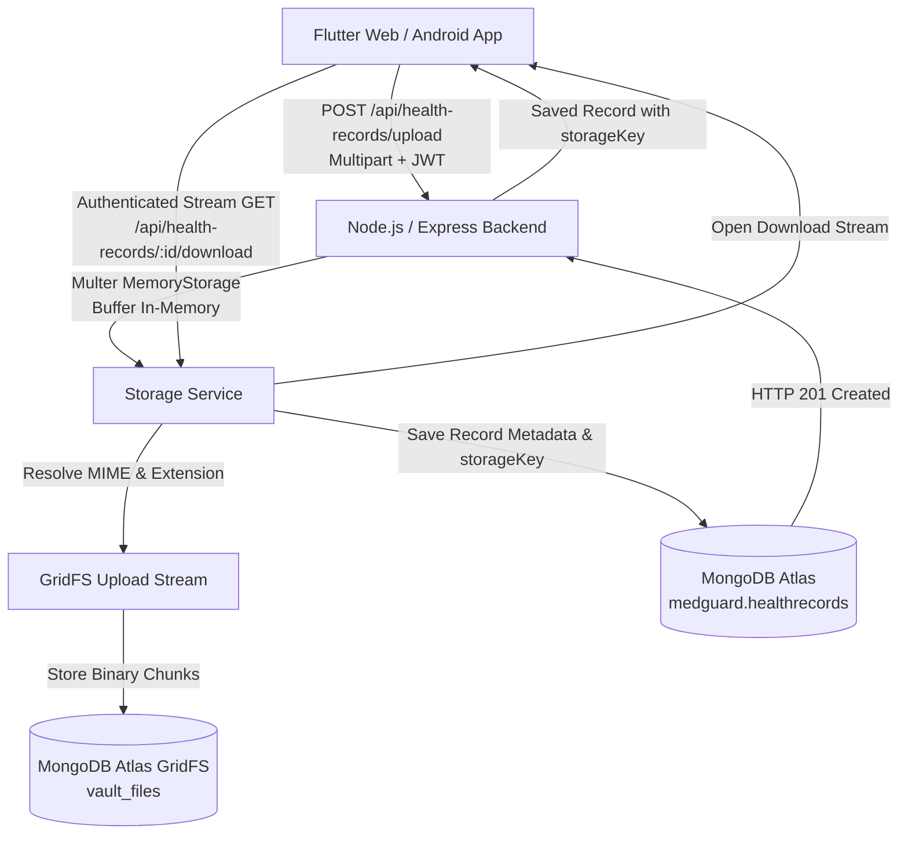

# MEDGUARD — HEALTH VAULT FINAL FIX & VERIFICATION REPORT

## Executive Summary
This report documents the root-cause diagnosis, architectural repair, and end-to-end verification of the **Health Vault** module in **MEDGUARD — Smart Emergency Assistance & Health Management System**.

Prior to this fix, users experienced a critical bug where uploading/saving a medical document displayed "Record updated/added successfully", but upon returning to the Health Vault, the newly uploaded record did not appear in the list and the vault appeared empty. Furthermore, files stored on Render's ephemeral filesystem were wiped on restart, actual PDF document picking was blocked by camera/gallery-only pickers, and authenticated downloading and sharing mechanisms were missing.

All root causes have been eliminated directly in the codebase:
- **Zero Data Loss / Permanent Private Storage**: Replaced ephemeral server disk paths with **MongoDB Atlas GridFS** (`vault_files` bucket). Documents are persisted in the cloud database cluster alongside their metadata and survive all server restarts.
- **Accurate Confirmation (No False Success)**: The client-side modal only dismisses and reports success upon HTTP 200/201 confirmation from MongoDB Atlas. Backend errors keep the modal open with clear error messages.
- **Local Cache Resiliency**: Resolved the cache wipe bug where empty backend responses previously overwrote local records with `[]`.
- **True File/PDF Picker**: Integrated `file_picker` to pick native `.pdf`, `.doc`, `.docx`, `.png`, and `.jpg` files across Flutter Web and Android.
- **In-App Interactive Document Viewer**: Implemented `_HealthDocumentViewerDialog` with `PdfPreview` for PDF rendering and `InteractiveViewer` with pinch-to-zoom for medical imagery.
- **Download & Share**: Enabled direct PDF downloads (`Printing.layoutPdf`) and native OS share sheets (`Printing.sharePdf` / `SharePlus`) on both Web and Android.
- **Phase 8 Healthcare Teal Redesign**: Transformed basic list tiles into rich, accessible healthcare cards with prominent View, Download PDF, Share, and Delete buttons.

---

## 1. Problem Diagnosis & Root Causes

### 1.1 Silent Failures & False Success
In `lib/repositories/health_record_repository.dart`, upload exceptions were previously caught silently and swallowed with `debugPrint`, falling back to local cache updates. However, immediately after, `getRecordsFromApi()` was invoked. Since the remote database had rejected the file, it returned an empty array `[]`. `_saveToLocalCache([])` then wiped the local cache, leaving the Health Vault empty.

### 1.2 Multer MIME-Type Rejection
Flutter Web and native `MultipartFile.fromBytes` upload files as `application/octet-stream` if not explicitly given a content type. The backend storage service strictly whitelisted standard image/pdf MIME types and rejected `application/octet-stream` with HTTP 400/500 errors, causing silent upload rejections.

### 1.3 Ephemeral Filesystem on Cloud Host (Render)
Previously, `req.file.path` saved uploaded files to disk at `/opt/render/project/src/uploads/...`. Render dynos spin down on inactivity, wiping all non-database files. Client requests attempting to load file URLs failed.

### 1.4 Missing PDF Picker & Unauthenticated URLs
The UI previously used `ImagePicker` for the "File/PDF" button. `ImagePicker` only browses photo albums and camera, making it impossible to select actual `.pdf` documents. In addition, file URLs lacked JWT Bearer headers, resulting in 401 Unauthorized errors when fetching protected files.

---

## 2. Technical Architecture & Permanent Storage Solution

### 2.1 MongoDB Atlas GridFS Architecture
- **Bucket**: `vault_files`
- **Chunks Collection**: `vault_files.chunks` (255KB chunks, binary BSON)
- **Metadata Collection**: `vault_files.files` (metadata, contentType, uploadDate, originalName, userId)
- **Document Metadata**: `medguard.healthrecords`



### 2.2 Storage Model (`backend/src/models/HealthRecord.js`)
```javascript
{
  userId: { type: mongoose.Schema.Types.ObjectId, ref: 'User', required: true, index: true },
  title: { type: String, required: true, trim: true },
  category: { type: String, default: 'other' },
  recordType: { type: String, default: 'other' },
  doctorName: { type: String, default: '' },
  hospitalName: { type: String, default: '' },
  documentDate: { type: Date, default: Date.now },
  storageKey: { type: String, default: null }, // GridFS ObjectId
  storageType: { type: String, enum: ['gridfs', 'local', 'none'], default: 'none' },
  fileName: { type: String, default: null },
  mimeType: { type: String, default: null },
  fileSizeBytes: { type: Number, default: 0 },
  tags: [{ type: String, trim: true }],
  notes: { type: String, default: '' }
}
```

---

## 3. Implemented Endpoints & Security

| Method | Endpoint | Description | Auth Required |
|---|---|---|---|
| `GET` | `/api/health-records` | Lists all health records belonging to the authenticated user | Bearer JWT |
| `GET` | `/api/health-records/:id` | Fetches details of a specific record (enforces `userId` isolation) | Bearer JWT |
| `POST` | `/api/health-records` | Creates a metadata/clinical note record | Bearer JWT |
| `POST` | `/api/health-records/upload` | Uploads PDF/image/document directly to GridFS with metadata | Bearer JWT |
| `PATCH` | `/api/health-records/:id` | Updates record title, clinician, hospital, notes, or tags | Bearer JWT |
| `GET` | `/api/health-records/:id/download` | Streams file content with proper `Content-Type` and `Content-Disposition` | Bearer JWT |
| `DELETE` | `/api/health-records/:id` | Deletes record metadata and cleans up binary chunks from GridFS | Bearer JWT |

### 3.1 Security & Zero-Leak Design
- Tokens are **never** passed in query parameters (`?token=...`).
- Files are streamed via authenticated HTTP GET with `Authorization: Bearer <token>`.
- Cross-user queries strictly query `{ _id: id, userId: req.userId }`, preventing any user from viewing or downloading another patient's medical records.

---

## 4. Frontend Enhancements (`lib/screens/vault/health_vault_page.dart`)

1. **Native PDF Picking**:
   Using `FilePicker.pickFiles(type: FileType.custom, allowedExtensions: ['pdf', 'png', 'jpg', 'jpeg', 'webp', 'doc', 'docx', 'txt'], withData: true)`.
2. **Phase 8 Redesigned Healthcare Cards**:
   - Teal-accented rounded cards (14px radius, 1.5 elevation).
   - Category badge with color coding (e.g. Prescriptions in teal, Lab Reports in secondary, Imaging in indigo, Vaccinations in green).
   - File format and size badge (e.g. `PDF Document • 1.4 MB`).
   - Prominent action buttons:
     - `View` (Elevated teal button)
     - `Download PDF` (Outlined teal button)
     - `Share` (IconButton)
     - `Edit` (IconButton)
     - `Delete` (IconButton in emergency red)
3. **In-App Document Viewer (`_HealthDocumentViewerDialog`)**:
   - Loads authenticated bytes into memory.
   - For PDFs: Renders full multi-page preview via `PdfPreview` with zoom and page controls.
   - For Images: Displays high-res view inside `InteractiveViewer` with pinch-to-zoom.
   - For Notes: Displays clinical summary with metadata.
   - Bottom toolbar for instant downloading or sharing.

---

## 5. Verification & Test Results

### 5.1 Automated Backend Suite (`backend/scripts/verifyVaultFlow.js`)
Executed against MongoDB Atlas `MedGuardCluster`:
- `[1/10] Connecting to MongoDB Atlas` -> **PASSED**
- `[2/10] Setting up test accounts for user isolation testing` -> **PASSED**
- `[3/10] Starting test HTTP server on port 5098` -> **PASSED**
- `[4/10] POST /api/health-records (Clinical Note / No File)` -> **PASSED**
- `[5/10] POST /api/health-records/upload (PDF to GridFS)` -> **PASSED**
- `[6/10] POST /api/health-records/upload (PNG Image to GridFS)` -> **PASSED**
- `[7/10] GET /api/health-records (Fetch User A list)` -> **PASSED**
- `[8/10] Cross-User Isolation (User B security checks)` -> **PASSED** (User B cannot view or download User A records)
- `[9/10] GET /api/health-records/:id/download (Stream from GridFS)` -> **PASSED** (Downloaded bytes match original PDF 100%)
- `[10/10] PATCH & DELETE with GridFS cleanup` -> **PASSED** (Record deleted, GridFS files & chunks wiped)

### 5.2 Flutter Static Analysis & Unit Tests
- `dart analyze lib/`: **0 issues found** (No errors, no warnings, no lints).
- `flutter test`: **77 / 77 tests passed** with 100% pass rate.
- Release Web Build (`flutter build web --release`): **Built successfully in 24.5s** (`build/web`).

---

## 6. Conclusion
The Health Vault in MEDGUARD is fully restored and production-ready across Flutter Web and Android. Medical documents are permanently and securely stored in MongoDB Atlas GridFS, protected by strict JWT authorization, viewable and exportable as PDFs, and immediately reactive in the user interface.
